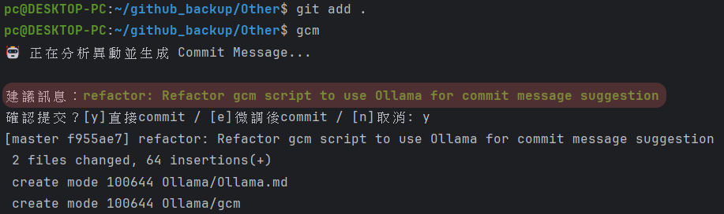

# Ollama WSL2 Installation Guide

### *Requirements*
```
sudo apt-get update && sudo apt-get install -y zstd
```

### *安裝 Ollama 主程式*
```
curl -fsSL https://ollama.com/install.sh -o install.sh
less install.sh
sh install.sh
```

### *下載模型（只需執行一次）*
```
ollama pull qwen2.5-coder:3b
```

### *確認是否生效*
```
$ ollama list
# 在終端機輸入 ollama list，只要看到列表裡有 qwen2.5-coder:3b，就代表隨時可以被 gcm 腳本呼叫了。

NAME                ID              SIZE      MODIFIED           
qwen2.5-coder:3b    f72c60cabf62    1.9 GB    About a minute ago 
```

---

### *設定 gcm 腳本*
```
nano ~/.bashrc
# 把 gcm 函式貼到家目錄下的 ~/.bashrc（macOS 或部分環境若用 zsh 則是 ~/.zshrc）：

source ~/.bashrc
# 立刻生效
```



---

### *停止服務*
```
# 查看硬碟中儲存模型
ollama list

# 查看目前有哪些模型被載入到記憶體中
ollama ps

# 正在運作模型 將其卸載 否則其會持續占用資源
ollama stop qwen2.5-coder:3b

# 停止 WSL2 / Linux 服務啟動
sudo systemctl stop ollama

# 刪除硬碟裡的模型
ollama rm qwen2.5-coder:3b
```

---

### *測試服務*
```
# 視窗 1 輸入
ollama run qwen2.5-coder:3b "用一句話解釋 git diff"

# 視窗 2 輸入
ollama ps
```


